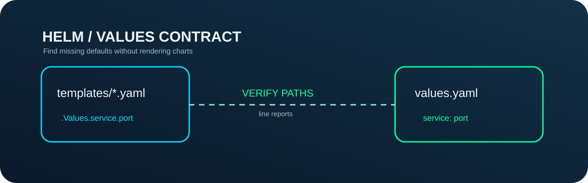

<p align="center"></p>

<p align="center"></p>

<h3 align="center">Catch stale chart values before a release.</h3>
<p align="center">Conservative static checks for Helm chart value references — an independently testable open-source Agent Skill for Claude Code and Codex.</p>
<p align="center"><a href="https://github.com/Kanompung1988/helm-values-contract-audit/actions/workflows/ci.yml"></a> <a href="https://agentskills.io/specification"></a> <a href="LICENSE"></a></p>

## The problem

A chart can refer to `.Values.service.port` while its defaults are refactored to `service.targetPort`. That mismatch is easy to miss in large Helm templates, and should be reviewed before releases.

## What it delivers

- **Static, read-only report.** No Docker daemon, network calls, credentials, cluster connections or write-side effects.
- **Deterministic evidence.** Machine-readable JSON and human-readable text with meaningful severity labels.
- **Honest boundaries.** Unsupported syntax and runtime-dependent behavior are not silently advertised as safe.
- **Agent-compatible workflow.** A self-contained `SKILL.md`, explicit trigger/avoid rules, reusable examples, regression tests and two-version CI.

## 90-second quickstart

```bash
git clone https://github.com/Kanompung1988/helm-values-contract-audit.git
cd helm-values-contract-audit
python -m pip install -r requirements.txt
python scripts/audit.py ./mychart --format text --fail-on review
```

### Reproducible synthetic example

```bash
python scripts/audit.py examples/chart --format json --fail-on review
python scripts/audit.py ./mychart --format json --fail-on never
```

Expected evidence includes `"key": "image.tag"`; this is a fixture, **not** a finding against a real production project.

## Install with an AI coding agent

A Skill is a directory with the root `SKILL.md` file. Clone this repository to a project-local skills directory named **`helm-values-contract-audit`**:

**Claude Code** (project local):

```bash
mkdir -p .claude/skills
git clone https://github.com/Kanompung1988/helm-values-contract-audit.git .claude/skills/helm-values-contract-audit
python -m pip install -r .claude/skills/helm-values-contract-audit/requirements.txt
```

**Codex** (project local):

```bash
mkdir -p .agents/skills
git clone https://github.com/Kanompung1988/helm-values-contract-audit.git .agents/skills/helm-values-contract-audit
python -m pip install -r .agents/skills/helm-values-contract-audit/requirements.txt
```

Then ask your agent to review a local Helm chart config using this Skill. Your agent should use the procedure in `SKILL.md`, cite exact findings, and recommend a manual platform-native validation step.

## Project map

| Path | Purpose |
|---|---|
| `SKILL.md` | Cross-platform activation and procedure |
| `scripts/audit.py` | Deterministic static analyzer (CLI + importable logic) |
| `tests/test_audit.py` | Regression/security-boundary tests |
| `examples/` | Synthetic safe/review cases |
| `references/MODEL.md` | Source-backed semantics, assumptions and limitations |
| `.github/workflows/ci.yml` | Python 3.10/3.12 + fixture smoke and metadata checks |
| `assets/hero.svg` | Original editorial diagram |
| `assets/area-zero-logo-full.svg` | Unmodified official project logo; not MIT-licensed |

## Important limitations

Not a Go template parser, Helm renderer, or policy checker. Missing chart defaults may be intentional because Helm values can come from `--set`, external files, parent charts or required input. Pipelines with `default`/`required` are informational. Dynamic access and aliases are not fully resolved; the result is a review signal, not proof of a broken deployment.

**For production:** run the platform-native check and review the real environment before relying on the result. Do not treat a heuristic scanner as an independent security audit.

## Reproduce and contribute

```bash
python -m unittest discover -s tests -v
python -m compileall -q scripts tests
```

See [CONTRIBUTING.md](CONTRIBUTING.md), [SECURITY.md](SECURITY.md) and [references/MODEL.md](references/MODEL.md). Code is MIT. Official Area Zero logo and brand identity are **excluded** from the MIT grant and remain with their respective rights holder; please replace them in unrelated forks.

## Authoritative references

- https://docs.helm.sh/docs/v3/chart_template_guide/values_files/
- https://docs.helm.sh/docs/chart_template_guide/functions_and_pipelines/
- https://helm.sh/docs/topics/charts/
